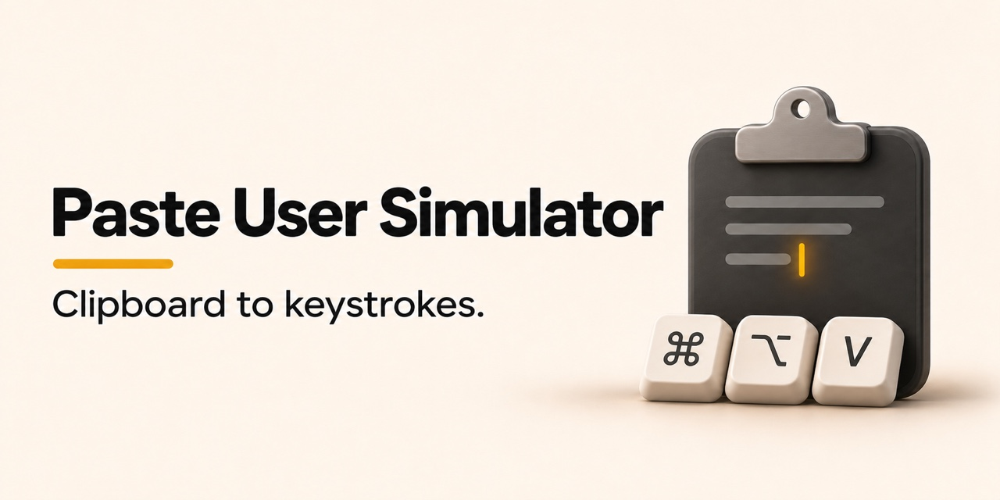

# Paste User Simulator

A small macOS menu bar app that types your clipboard text one character at a time.

## Install

Download the ZIP from [GitHub Releases](https://github.com/mattivilola/paste-user-simulator/releases/latest), unzip it and move **Paste User Simulator** to Applications. It runs on macOS 13 or later on Apple silicon and Intel. Sparkle checks GitHub for updates.

## Use

1. Open the app and copy some text. The menu bar clipboard icon fills when text is available.
2. Focus a text field and press **⌘⌥V**. On first use, allow Paste User Simulator in **System Settings → Privacy & Security → Accessibility**. Then return to your text field and press the shortcut again.
3. Press the same shortcut again to stop. Typing stops when you switch apps or move focus to a different field.

Open **Settings** from the menu bar to change the shortcut or speed. The default is 300 characters per minute, with a little variation and extra time after punctuation.

**Typos per 100 letters** is off by default. Set it to 1–10 to occasionally type a nearby key, pause, then backspace and type the intended letter. The rate is an average for A–Z letters in fields that expose their text and caret position. If typing is interrupted mid-correction, check the last letter.

**Keep typing after switching apps** lets you work in another app while typing continues in the original field. The destination must keep that field focused in its own window and accept background keystrokes. The type/stop shortcut works from either app.

The app uses Shift-Return for line breaks in multiline fields.

The app reads text when you trigger the shortcut and keeps it in memory for that typing session. It keeps no clipboard history and sends no clipboard data over the network. Input behavior can vary by app and text field.

## Build

Open `macosx/PasteUserSimulator.xcodeproj` in Xcode or run `./macosx/scripts/build_and_run.sh` from the repository root. Development builds run with a separate bundle ID and no update feed.

The app is MIT-licensed. Its update framework, [Sparkle](https://github.com/sparkle-project/Sparkle), uses its own license.
